This is a plain-English setup guide for the Meshtastic Android app. The goal is to get a new node
working without needing to understand every radio detail first. It was written against Android app
2.8.1 and firmware 2.7.26, so if your screens look a little different, that's probably why.

On an iPhone? There's a separate [iOS version of this guide](../setting-up-meshtastic-on-ios/).

## Before you start

Come say hi on **[Discord](../../discord/)**. The parrot bot there can confirm your messages are
actually reaching the mesh, which is the fastest way to know your setup works.

Some things to expect:

- The mesh can be slow and laggy. Messages drop, you may not see any direct nodes, and replies can
  take a while. It's still fun.
- **Nobody owes you a reply to "test".** Try [node discovery](#9-node-discovery) first. And if you
  don't know your node's ID or have a unique long name, any reply you get could be meant for one of
  the hundred other "test" messages that go out every day.
- Not everyone on the public channel is polite. Some people play a character, some dump random
  text, and some say ugly things. Learn to use the ignore function, it's under
  [advanced functions](#10-advanced-functions).

**Most screens need you to scroll to the bottom and press Save.** Your radio will often reboot and
reconnect after a change. It's annoying, but you should only have to do this setup once.

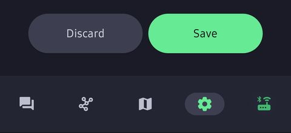

*This is the Save button. You'll be pressing it a lot.*

## 1. User settings

Start with your identity. This is how people recognize you and reply to you.

- **Long Name:** something that helps people tell who you are when they reply.
- **Short Name:** 4 characters, or an emoji if you'd rather.
- **Save:** scroll down and press it.

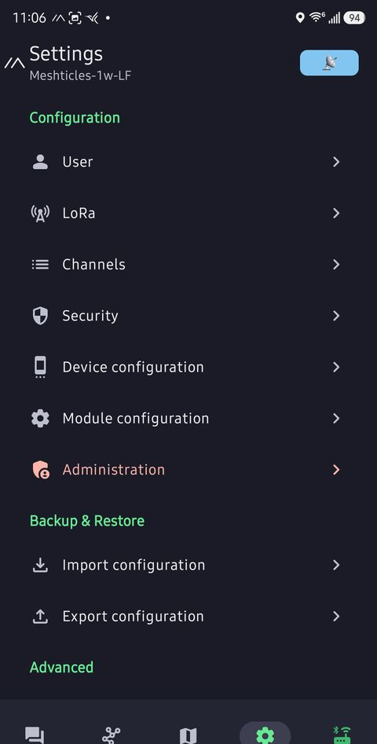

*The main settings screen. User is at the top.*

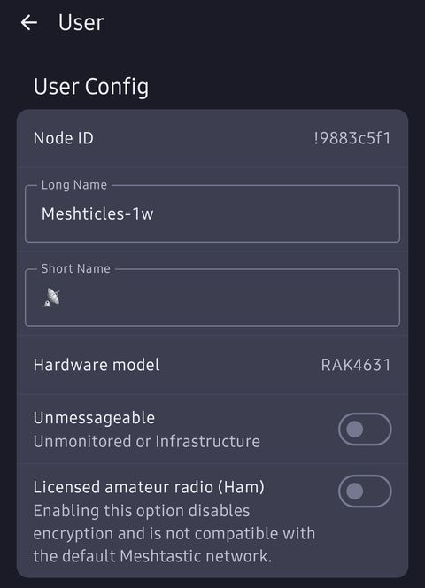

*Long name, short name, then Save.*

## 2. LoRa settings (important)

These control the radio side of things. Start conservative and don't flood the network.

- **Region:** United States
- **Preset:** LONG_TURBO
- **Ignore MQTT:** on
- **OK to MQTT:** on
- **Transmit Enabled:** on
- **Number of Hops:** 3 or 5, so you don't flood the network.
- **Frequency Slot:** make sure it says **14**, or you'll be on your own.
- **Transmit Power:** leave it at 30. There's no benefit to changing it until you know what you're
  doing and have hardware that can make use of it.
- **Save:** scroll down and press it.

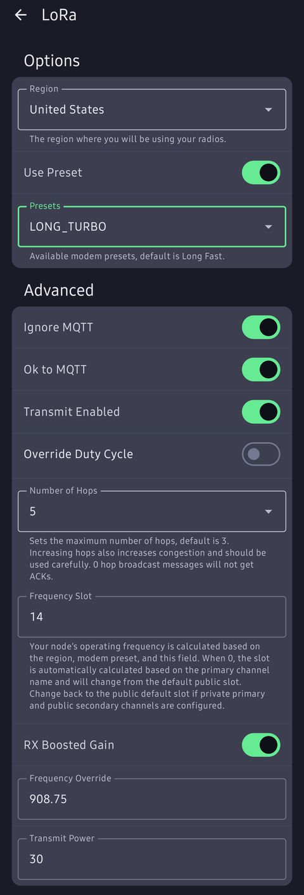

*Region, preset, MQTT, hops and slot. The Frequency Override box shows 908.75 here; slot 14 on
LongTurbo already lands on 908.75 MHz, so you can leave the override at 0.*

## 3. Channel settings

Open your primary channel and use these as a starting point.

- **MQTT Uplink Enabled:** on. This lets public messages your radio hears be passed up to the
  internet.
- **MQTT Downlink Enabled:** off. Turning it on floods the mesh.
- **Position enabled:** on.
- **Location slider:** use this if you have GPS or want to show up on the map. Leave
  **Precise location** off and pick a fuzzy distance.

Press **Save** in the channel box, then **Send** to push the change to your radio.

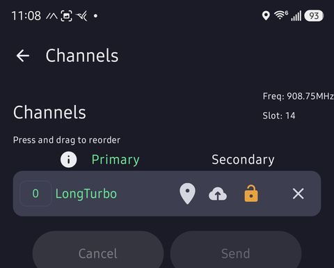

*Tap your primary channel.*

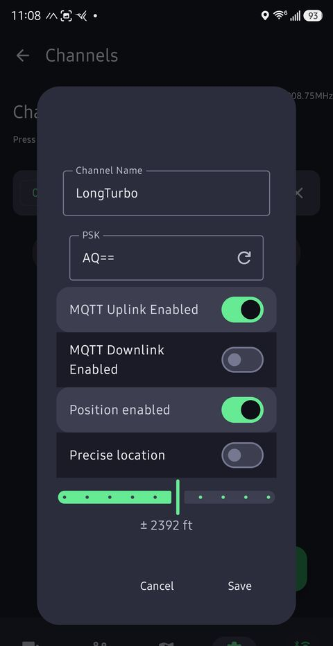

*Uplink on, downlink off, position on, fuzzy location.*

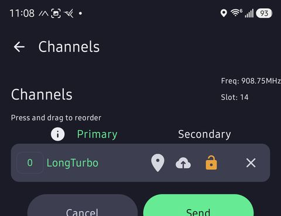

*Press Send so the radio gets the change.*

## 4. Device configuration

These make your node behave like a normal user node and help other people identify it.

- **Device Role:** CLIENT. If you're not sure, this is the one. See
  [Best practices](../best-practices/) for when another role makes sense.
- **Node Info Broadcast Interval:** 3 hours. This is what pushes your friendly name out to the mesh.
- **Time Zone:** a GPS radio can work this out. Otherwise, use your phone's time zone.
- **Bluetooth PIN:** change it from the default.
- **Save:** scroll down and press it.

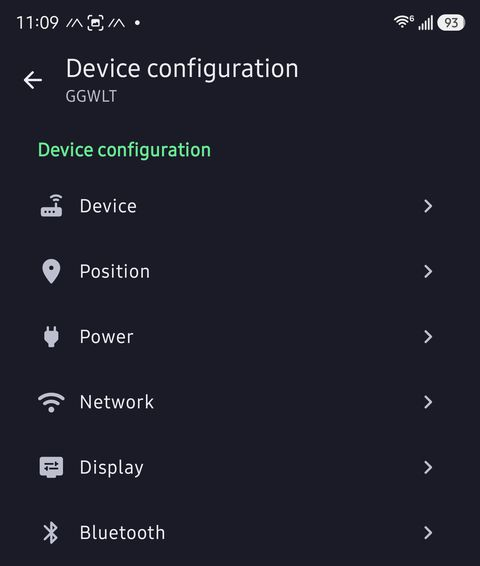

*Device configuration. Role and node info are under Device, the PIN is under Bluetooth.*

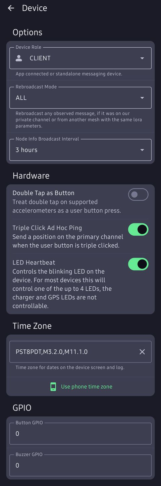

*Role, node info interval and time zone. Tap "Use phone time zone" if your radio has no GPS.*

## 5. Position settings

What you set here depends on whether the node moves around or stays put.

**Mobile nodes**, like one you carry with your phone:

- **Broadcast Interval:** 15 or 30 minutes. Shorter means more traffic on the mesh.
- **Smart Position:** on.
- **Smart Interval:** the same as the broadcast interval.

**Fixed nodes:**

- Use **Fixed Position** only on a node that doesn't move.
- Set the intervals much longer, since the location isn't changing.

Then scroll down and press **Save**.

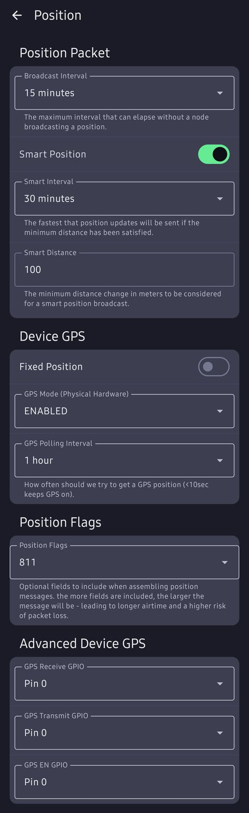

*Broadcast interval, smart position and GPS settings.*

## 6. MQTT (optional)

MQTT isn't really mesh in the pure radio sense. It uses the internet to carry your messages, and
the mesh works fine without it. Think of it as a last resort that turns your phone and radio into a
complicated way to send a text.

Only use it if you know why you need it. It can be helpful, but it also defeats the point of
testing how far your radio really reaches. For the full set of our broker settings, see
[How do I uplink to MQTT](../how-do-i-uplink-to-mqtt/).

- **MQTT Enabled:** on, only if you're using MQTT.
- **Address:** `mqtt.socalmesh.org`
- **Username:** `meshdev` and **Password:** `large4cats`. These are the shared public ones for
  our broker, they're meant to be public.
- **Encryption Enabled:** on.
- **Root Topic:** `msh/US/CA/socalmesh` (it's case sensitive).
- **Proxy to Client Enabled:** on if you're using your phone's internet to send messages.
- **Map Reporting:** optional. Pick a vague distance for privacy.
- **Save:** scroll down and press it.

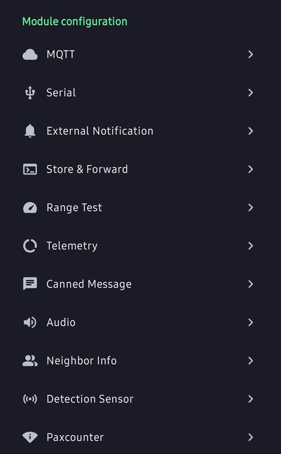

*MQTT is under Module configuration.*

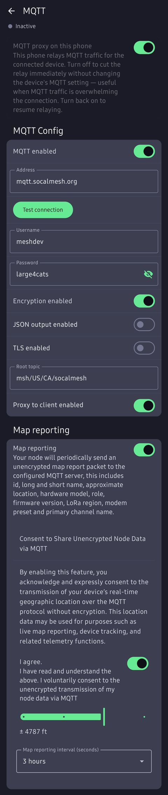

*Server, encryption, topic, proxy and map reporting.*

## 7. Your first message

### Go outside

If you can't see any nodes, give it about 15 minutes and get some height. The top floor of a
parking garage, a hill or any open area makes a big difference. You can also
[scan for nodes](#9-node-discovery).

### Send something worth answering

- Open **Messages** and pick your primary channel (LongTurbo).
- Keep it short.
- Say something unique, so a reply is clearly to you and not to the void. Know your node ID, or
  have a long name nobody else has.

### Check for your node

- Open the **Nodes** page in the app.
- Filter to show direct nodes only.
- If you still see nothing after about 30 minutes, turn the filters off.
- Tried [discovering nodes](#9-node-discovery)?

Nodes may only announce themselves every few hours. Someone can be out there even if they haven't
shown up on your list yet.

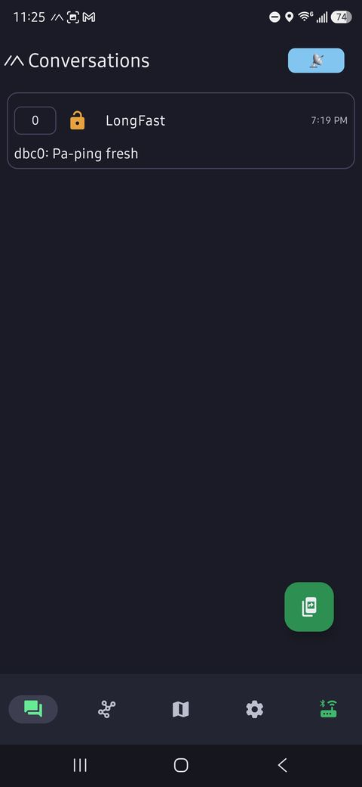

*Pick the primary channel. By default it's the only one. (This screenshot was taken on LongFast; yours
will say LongTurbo.)*

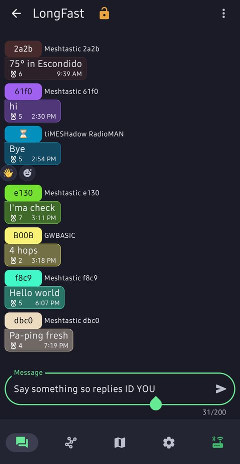

*Say something worth replying to, not just "test". (This screenshot was taken on LongFast.)*

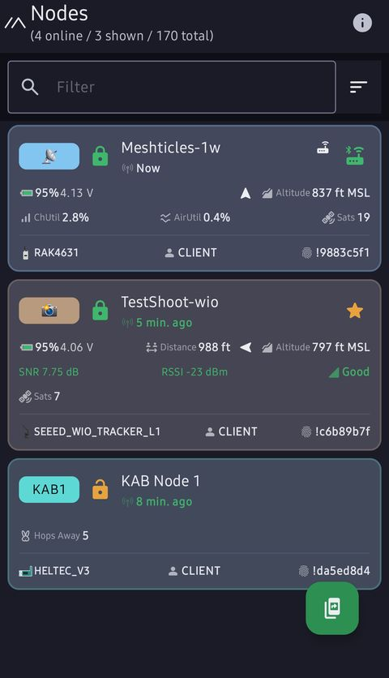

*Pretend Meshticles-1w is you.*

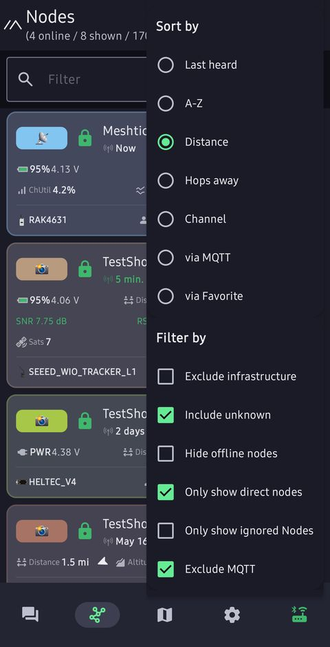

*The filter options. Tick "Only show direct nodes".*

## 8. Check it worked with the parrot

If you're on the SoCal Mesh [Discord](../../discord/), you can link your node and watch your first
message arrive.

1. Open the Meshtastic app.
2. Go to the **Nodes** page.
3. Tap your node.
4. Copy the **User ID**. It looks something like `!1234abcd`.
5. Go to Discord (general is fine) and type `/linknode`.
6. Paste your node ID into the field.
7. Send a message from the Meshtastic app.
8. Watch the parrot in **Node Monitoring → meshtastic-lt14**. Your message should show up in a few
   moments.

The parrot's post is handy because it shows how many hops your message took to reach it. If you
linked your node and set a long name in step 1, your name shows up too.

*Tap your own node.*

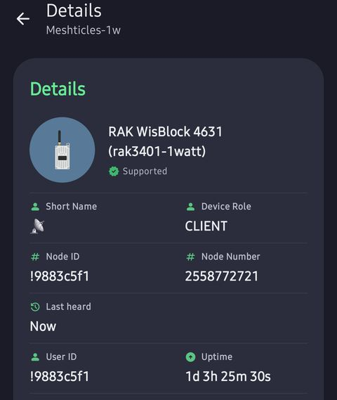

*Your node's details. Note the Node ID.*

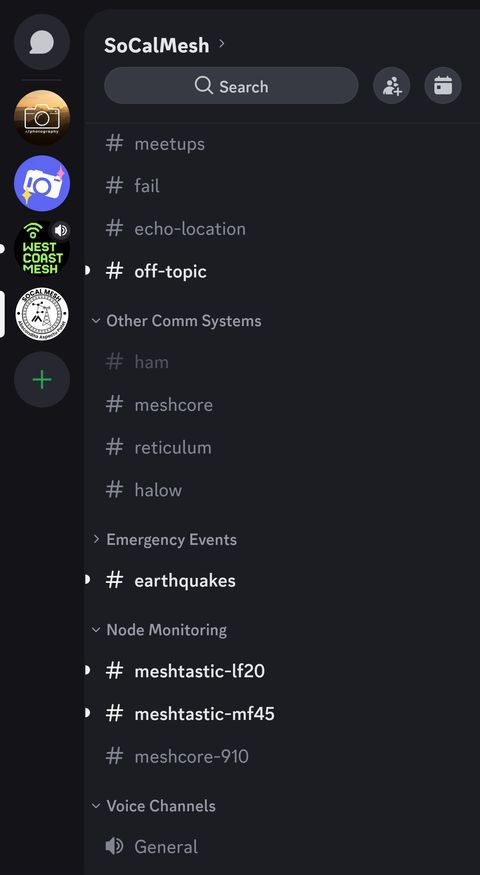

*The Discord channel list. Node Monitoring is near the bottom; look for the lt14 channel.*

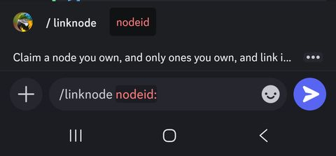

*Type `/linknode`, paste your node ID and press Enter.*

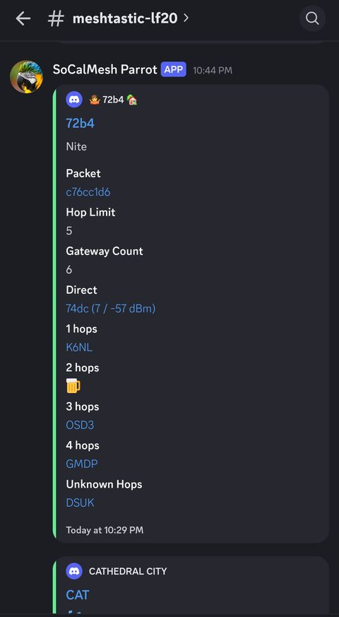

*If it worked, the parrot posts your message, your name if you linked it, and how many hops it
took. (This one was on the LF20 channel.)*

## 9. Node discovery

The app can scan for nodes around you, on whichever presets you pick, and tell you which one has
the most going on.

**Setting it up:**

- Pick the presets to scan.
- Set how long to scan for.
- Optionally keep the screen on while it runs.

**What you get:**

- A summary of the session.
- Results for each preset separately.
- An analysis of what it heard, with a suggestion for which preset to stay on.
- Results aren't saved to the radio, so screenshot anything you want to keep.

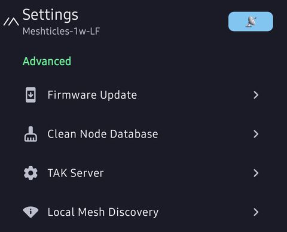

*Settings → Advanced → Local Mesh Discovery.*

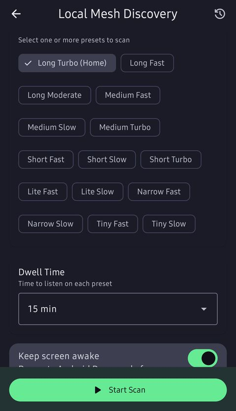

*Pick the presets and the duration. The longer the scan, the more likely you are to find nodes.*

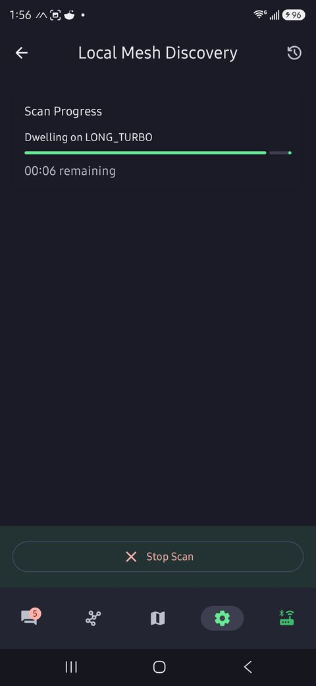

*Scan in progress.*

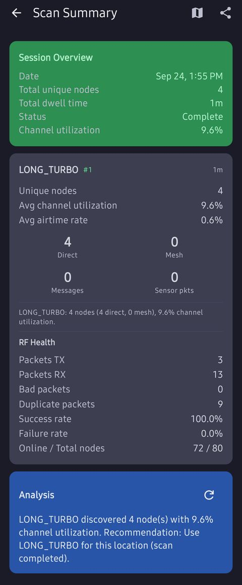

*The results, with a recommendation at the bottom.*

## 10. Advanced functions

**Filtering:** hide messages containing words or patterns you don't want to see.

**Blocking users:** also known as ignore.

**Canned messages:** stored on a radio that has its own screen, like a
[Wio Tracker L1 Pro](https://www.seeedstudio.com/Wio-Tracker-L1-Pro-p-6454.html) or a
[ThinkNode M1](https://www.elecrow.com/thinknode-m1-meshtastic-lora-signal-transceiver-powered-by-nrf52840-with-154-screen-support-gps.html).
They're separated by pipes (`|`) and are a bit limited.

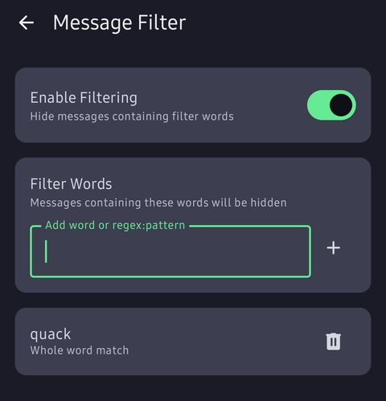

*Pick words to filter out of your messages.*

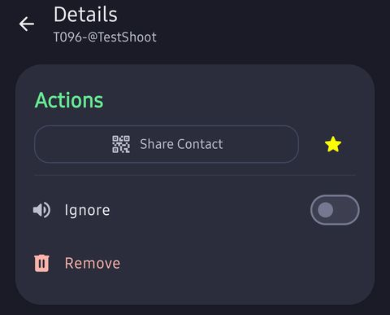

*Tap a node, then flip Ignore.*

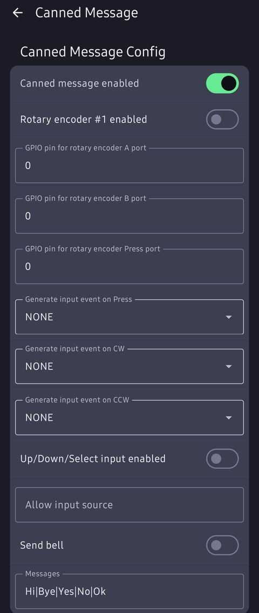

*Manage your canned messages.*
