This is a plain-English setup guide for the Meshtastic iOS app. The goal is to get a new node
working without needing to understand every radio detail first. It was written against iOS app
2.7.22 and firmware 2.7.26, so if your screens look a little different, that's probably why.

The iOS app is missing a few things the Android app has, though it's catching up. This guide has
screenshots for the setup steps; the later steps work the same way as the
[Android version of this guide](../setting-up-meshtastic-on-android/), which has pictures for
those too.

## Before you start

Come say hi on **[Discord](../../discord/)**. The parrot bot there can confirm your messages are
actually reaching the mesh, which is the fastest way to know your setup works.

Some things to expect:

- The mesh can be slow and laggy. Messages drop, you may not see any direct nodes, and replies can
  take a while. It's still fun.
- **Nobody owes you a reply to "test".** Try [node discovery](#9-node-discovery) first. And if you
  don't know your node's ID or have a unique long name, any reply you get could be meant for one of
  the hundred other "test" messages that go out every day.
- Not everyone on the public channel is polite. Some people play a character, some dump random
  text, and some say ugly things. Learn to ignore people, there's more on that under
  [advanced functions](#10-advanced-functions).

**Most screens need you to press Save.** Your radio will often reboot and reconnect after a change.
It's annoying, but you should only have to do this setup once.

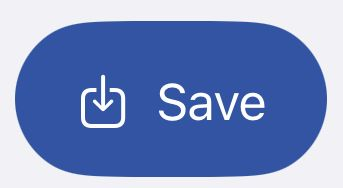

*This is the Save button. You'll be pressing it a lot.*

## 1. User settings

Start with your identity. This is how people recognize you and reply to you.

- **Long Name:** something that helps people tell who you are when they reply.
- **Short Name:** 4 characters, or an emoji if you'd rather.
- **Save.**

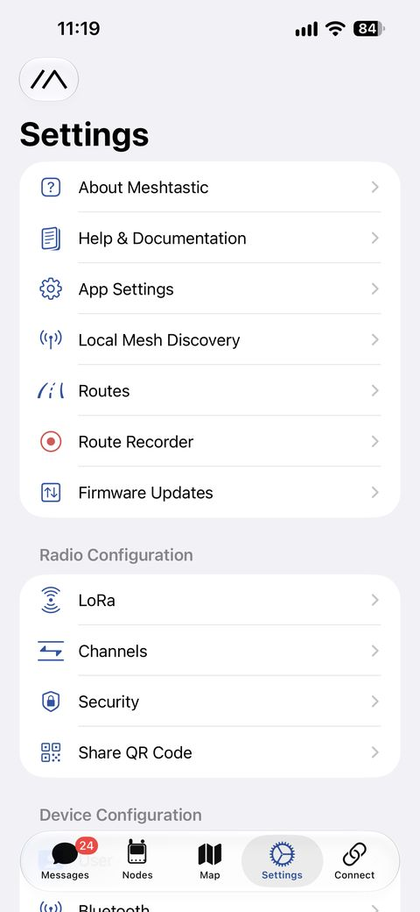

*The Settings tab. User is under Device Configuration, further down.*

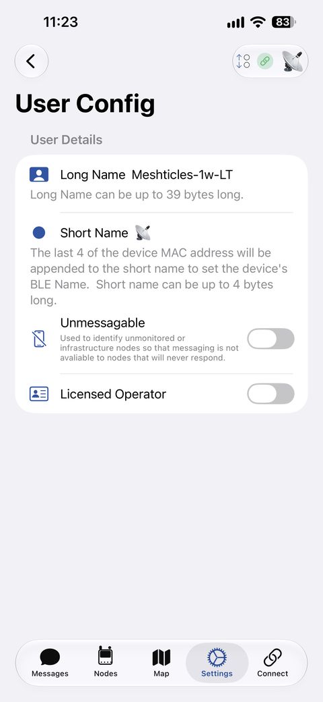

*Long name and short name.*

## 2. LoRa settings (important)

These control the radio side of things. Start conservative and don't flood the network.

- **Region:** United States
- **Preset:** Long Range - Turbo
- **Ignore MQTT:** on
- **OK to MQTT:** on
- **Transmit Enabled:** on
- **Number of hops:** 3 or 5, so you don't flood the network.
- **Frequency Slot:** make sure it says **14**, or you'll be on your own.
- **Transmit Power:** leave it at 30. There's no benefit to changing it until you know what you're
  doing and have hardware that can make use of it.
- **Save.**

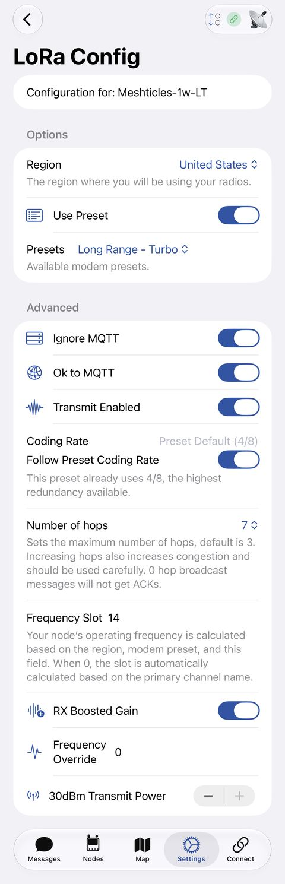

*Region, preset, MQTT and slot. This one has hops at 7; set yours to 3 or 5.*

## 3. Channel settings

Open your primary channel and use these as a starting point.

- **MQTT Uplink Enabled:** on. This lets public messages your radio hears be passed up to the
  internet.
- **MQTT Downlink Enabled:** off. Turning it on floods the mesh.
- **Positions Enabled:** on.
- **Approximate Location:** use the slider if you have GPS or want to show up on the map. Pick a
  fuzzy distance.
- **Save.**

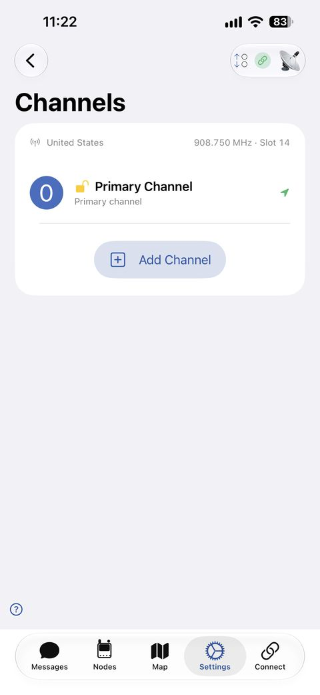

*Tap "Primary Channel". The top line should say 908.750 MHz, Slot 14.*

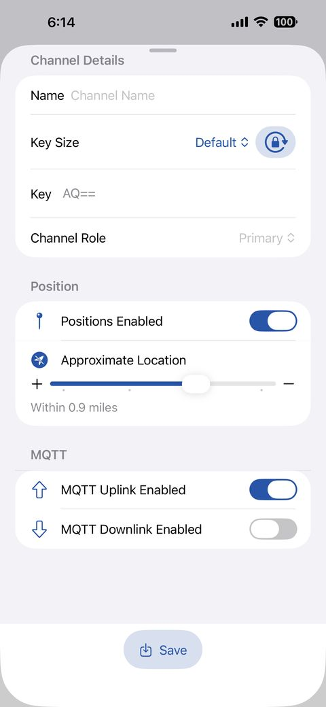

*Positions on, a fuzzy location, uplink on, downlink off, then Save.*

## 4. Device configuration

These make your node behave like a normal user node and help other people identify it.

- **Device Role:** Client. If you're not sure, this is the one. See
  [Best practices](../best-practices/) for when another role makes sense.
- **Node Info Broadcast Interval:** Three Hours. This is what pushes your friendly name out to the
  mesh.
- **Time Zone:** a GPS radio can work this out. Otherwise, use your phone's time zone.
- **Bluetooth PIN:** change it from the default.
- **Save.**

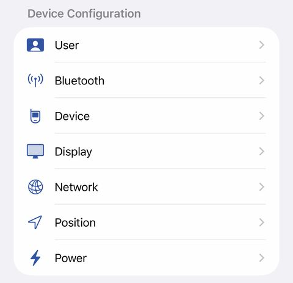

*Device Configuration. Role is under Device, the PIN is under Bluetooth.*

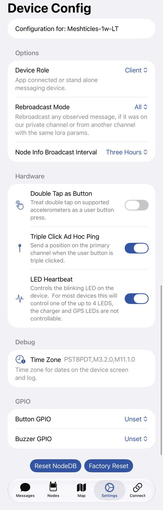

*Role, node info interval and time zone.*

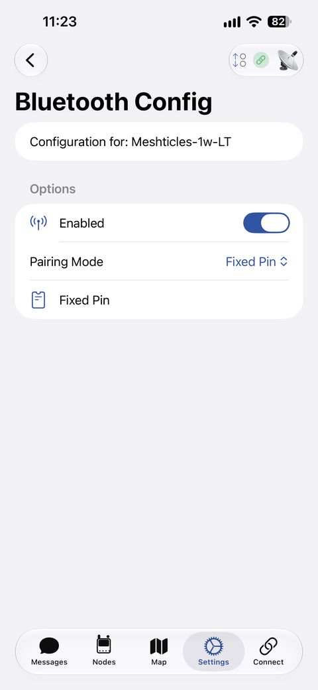

*Change the radio's Bluetooth PIN here.*

## 5. Position settings

What you set here depends on whether the node moves around or stays put.

**Mobile nodes**, like one you carry with your phone:

- **Broadcast Interval:** 15 or 30 minutes. Shorter means more traffic on the mesh.
- **Smart Position:** on.
- **Minimum Interval:** the same as the broadcast interval.

**Fixed nodes:**

- Use a fixed position only on a node that doesn't move.
- Set the intervals much longer, since the location isn't changing.

Then **Save**.

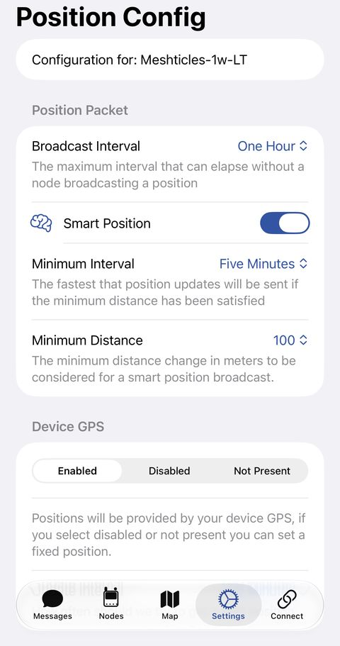

*Broadcast interval, smart position and GPS. The numbers in this screenshot are different from
the ones above; go with the list.*

## 6. MQTT (optional)

MQTT isn't really mesh in the pure radio sense. It uses the internet to carry your messages, and
the mesh works fine without it. Think of it as a last resort that turns your phone and radio into a
complicated way to send a text.

Only use it if you know why you need it. It can be helpful, but it also defeats the point of
testing how far your radio really reaches. For the full set of our broker settings, see
[How do I uplink to MQTT](../how-do-i-uplink-to-mqtt/).

- **Enabled:** on, only if you're using MQTT.
- **Address:** `mqtt.socalmesh.org`
- **Username:** `meshdev` and **Password:** `large4cats`. These are the shared public ones for
  our broker, they're meant to be public.
- **Encryption Enabled:** on.
- **Root Topic:** `msh/US/CA/socalmesh` (it's case sensitive).
- **MQTT Client Proxy:** on if you're using your phone's internet to send messages.
- **Map Report:** optional. Pick a vague distance for privacy.
- **Save.**

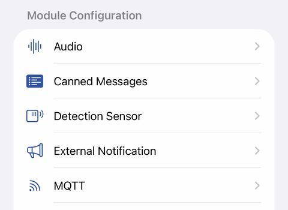

*MQTT is under Module Configuration.*

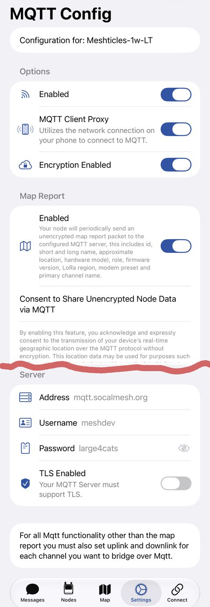

*Proxy, encryption, map report and server. The root topic is further down.*

## 7. Your first message

### Go outside

If you can't see any nodes, give it about 15 minutes and get some height. The top floor of a
parking garage, a hill or any open area makes a big difference. You can also
[scan for nodes](#9-node-discovery).

### Send something worth answering

- Open **Messages** and pick your primary channel.
- Keep it short.
- Say something unique, so a reply is clearly to you and not to the void. Know your node ID, or
  have a long name nobody else has.

### Check for your node

- Open the **Nodes** tab.
- Filter to show direct nodes only.
- If you still see nothing after about 30 minutes, turn the filters off.
- Tried [discovering nodes](#9-node-discovery)?

Nodes may only announce themselves every few hours. Someone can be out there even if they haven't
shown up on your list yet.

## 8. Check it worked with the parrot

If you're on the SoCal Mesh [Discord](../../discord/), you can link your node and watch your first
message arrive.

1. Open the Meshtastic app.
2. Go to the **Nodes** tab.
3. Tap your node.
4. Copy the **User ID**. It looks something like `!1234abcd`.
5. Go to Discord (general is fine) and type `/linknode`.
6. Paste your node ID into the field.
7. Send a message from the Meshtastic app.
8. Watch the parrot in **Node Monitoring → meshtastic-lt14**. Your message should show up in a few
   moments.

The parrot's post is handy because it shows how many hops your message took to reach it. If you
linked your node and set a long name in step 1, your name shows up too.

## 9. Node discovery

The app can scan for nodes around you, on whichever presets you pick, and tell you which one has
the most going on. On iOS it's **Settings → Local Mesh Discovery**, near the top.

**Setting it up:**

- Pick the presets to scan.
- Set how long to scan for.
- Optionally keep the screen on while it runs.

**What you get:**

- A summary of the session.
- Results for each preset separately.
- An analysis of what it heard, with a suggestion for which preset to stay on.
- Results aren't saved to the radio, so screenshot anything you want to keep.

## 10. Advanced functions

**Filtering:** hide messages containing words or patterns you don't want to see.

**Blocking users:** also known as ignore.

**Canned messages:** stored on a radio that has its own screen, like a
[Wio Tracker L1 Pro](https://www.seeedstudio.com/Wio-Tracker-L1-Pro-p-6454.html) or a
[ThinkNode M1](https://www.elecrow.com/thinknode-m1-meshtastic-lora-signal-transceiver-powered-by-nrf52840-with-154-screen-support-gps.html).
They're separated by pipes (`|`) and are a bit limited. On iOS they're under
**Module Configuration → Canned Messages**.
